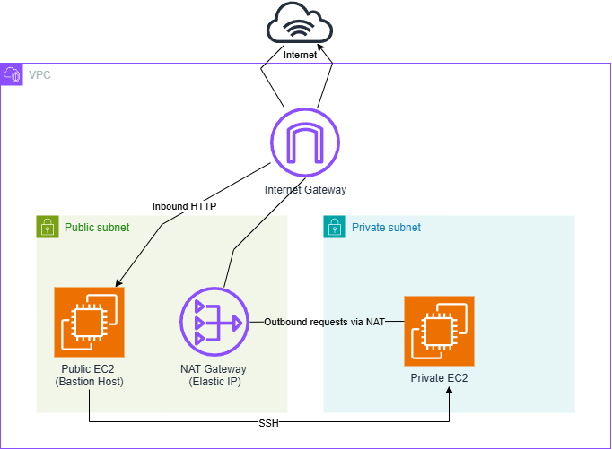
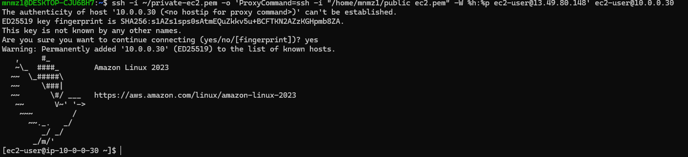

# AWS VPC & EC2 Networking Project

## Project Overview

This project demonstrates the design and configuration of a custom AWS Virtual Private Cloud (VPC) environment, incorporating public and private subnets, EC2 instances, and secure network routing.

The objective was to gain hands-on experience with AWS networking fundamentals by building a network infrastructure from scratch, configuring internet connectivity, controlling network access, and understanding how AWS resources communicate within a VPC.

The infrastructure was provisioned manually using the AWS Management Console to develop a practical understanding of the underlying networking components.

A key aspect of this project was implementing a **bastion host** to provide secure SSH access to a private EC2 instance without exposing it directly to the internet.

## Architecture

The architecture consists of a custom AWS VPC containing a public and private subnet, designed to separate internet-facing resources from internal infrastructure.

An Internet Gateway provides internet connectivity for the public subnet, while a NAT Gateway allows the private EC2 instance to initiate outbound internet connections without requiring a public IP address.

The public EC2 instance also acts as a **bastion host**, providing a secure entry point for SSH access to the private EC2 instance.

### Architecture Diagram

### Network Components

- **VPC:** Provides an isolated virtual network within AWS.
- **Public Subnet:** Hosts the public EC2 instance (bastion host) and NAT Gateway.
- **Private Subnet:** Hosts the private EC2 instance without direct internet exposure.
- **Internet Gateway (IGW):** Enables internet connectivity for public resources.
- **NAT Gateway:** Allows private resources to initiate outbound internet connections without exposing them to unsolicited inbound connections.
- **Route Tables:** Control network traffic by directing packets to the appropriate gateways or destinations.
- **Security Groups:** Act as virtual firewalls to control inbound and outbound traffic for EC2 instances.
- **Bastion Host:** Provides a controlled SSH entry point to the private EC2 instance.

## Implementation

### 1. VPC and Subnet Configuration

Created a custom Virtual Private Cloud (VPC) to establish an isolated network environment within AWS.

The VPC was divided into two subnets to separate public-facing resources from private infrastructure:

- **Public Subnet:** Hosts the public EC2 instance and NAT Gateway, with internet-bound traffic routed through the Internet Gateway.
- **Private Subnet:** Hosts the private EC2 instance without a public IP address, preventing direct access from the internet.

This separation allows public resources to communicate with the internet while keeping private infrastructure isolated from direct external access.

#### VPC Configuration

#### Subnet Configuration

### 2. Internet Gateway Configuration

Created an **Internet Gateway (IGW)** and attached it to the custom VPC to enable communication between public resources and the internet.

The Internet Gateway provides a path for inbound and outbound internet traffic, provided the resources have appropriate routing, public IP addresses, and security group rules.

- Created an Internet Gateway and attached it to the VPC.
- Configured the public subnet's route table with a default route (`0.0.0.0/0`) pointing to the Internet Gateway.
- Enabled internet connectivity for the public EC2 instance through its public IPv4 address.

This configuration allows the public EC2 instance to communicate with the internet while the private EC2 instance remains inaccessible directly from the internet.

#### Internet Gateway Configuration

### 3. NAT Gateway and Elastic IP Configuration

Created a **NAT Gateway** in the public subnet to allow the private EC2 instance to initiate outbound internet connections without requiring a public IP address.

An **Elastic IP (EIP)** was allocated and associated with the NAT Gateway to provide a static public IPv4 address for outbound internet traffic.

- Allocated an Elastic IP address.
- Created a public NAT Gateway within the public subnet.
- Associated the Elastic IP with the NAT Gateway.
- Configured the private subnet's route table with a default route (`0.0.0.0/0`) pointing to the NAT Gateway.
- Enabled outbound internet connectivity for the private EC2 instance without exposing it to unsolicited inbound internet connections.

This configuration allows the private EC2 instance to access external services, such as software repositories for package updates, while remaining inaccessible directly from the internet.

#### Elastic IP Configuration

#### NAT Gateway Configuration

### 4. Route Table Configuration

Configured separate route tables for the public and private subnets to control how network traffic is directed within the VPC and towards the internet.

#### Public Route Table

- Created a public route table and associated it with the public subnet.
- Configured the default route (`0.0.0.0/0`) to direct internet-bound traffic through the Internet Gateway.
- Retained the local route to allow communication between resources within the VPC.

#### Private Route Table

- Created a private route table and associated it with the private subnet.
- Configured the default route (`0.0.0.0/0`) to direct outbound internet traffic through the NAT Gateway.
- Retained the local route to allow communication between resources within the VPC.

This configuration allows the public EC2 instance to communicate directly with the internet, while the private EC2 instance uses the NAT Gateway for outbound internet connectivity.

#### Route Table Configuration

---

### 5. EC2 Instance Deployment

Deployed two Amazon EC2 instances within the custom VPC, placing one in the public subnet and the other in the private subnet.

The objective was to demonstrate how EC2 instances can operate in different network environments with distinct accessibility and security requirements.

#### Public EC2 Instance

- Launched an EC2 instance within the public subnet.
- Assigned a public IPv4 address to enable external connectivity.
- Configured the instance's security group to restrict inbound access.
- Used the instance as a bastion host to establish SSH connections to the private EC2 instance.

#### Private EC2 Instance

- Launched a second EC2 instance within the private subnet.
- Configured the instance without a public IPv4 address.
- Restricted inbound connectivity using security group rules.
- Used the public EC2 instance as a bastion host to access the private instance through SSH.

This deployment demonstrates how public and private infrastructure can coexist within the same VPC while maintaining different levels of network accessibility.

#### EC2 Instance Configuration

---

### 6. Security Group Configuration

Configured AWS Security Groups to control inbound and outbound traffic for both EC2 instances.

Security Groups act as stateful virtual firewalls, allowing administrators to define which network connections are permitted.

#### Public EC2 Security Group

- Configured inbound SSH access (port 22) from a trusted IP address.
- Restricted unnecessary inbound connections.
- Allowed outbound traffic required for connectivity.

#### Private EC2 Security Group

- Configured inbound SSH access (port 22) from the public EC2 instance's security group.
- Prevented direct SSH access from the internet.
- Allowed outbound traffic required for communication through the NAT Gateway.

These security configurations demonstrate the principle of least privilege by limiting access to only the connections required for the infrastructure to function.

---

### 7. Bastion Host and SSH Connectivity

Implemented a **bastion host** to provide secure administrative access to the private EC2 instance without assigning it a public IP address.

The public EC2 instance serves as an entry point into the private network, allowing SSH connections to be established securely.

#### SSH Connection Process

1. Established an SSH connection from my local machine to the public EC2 instance using its public IPv4 address.
2. Used the public EC2 instance as a jump host to reach the private EC2 instance.
3. Connected to the private EC2 instance using its private IPv4 address.
4. Used SSH authentication and security group rules to control access between the instances.

This approach allows administrators to manage private infrastructure without exposing private EC2 instances directly to the internet.

#### Bastion Host Connectivity

---

## Challenges and Troubleshooting

During the implementation, I encountered several networking and connectivity issues that required troubleshooting.

### 1. Internet Gateway Attachment

**Issue:**
Initially encountered routing configuration errors because the Internet Gateway was not correctly attached to the VPC.

**Solution:**
Attached the Internet Gateway to the custom VPC and configured the public route table to direct internet-bound traffic through it.

**Learning:**
Understood the importance of correctly associating gateways and route tables to establish internet connectivity.

### 2. NAT Gateway Configuration

**Issue:**
Encountered difficulties configuring outbound internet connectivity for resources in the private subnet.

**Solution:**
Configured the NAT Gateway within the public subnet, associated an Elastic IP, and ensured that the private route table directed internet-bound traffic towards the NAT Gateway.

**Learning:**
Developed a clearer understanding of how NAT Gateways enable outbound internet access for private instances without requiring public IP addresses.

### 3. SSH Key Permissions

**Issue:**
Encountered an SSH authentication error because the private key file had overly permissive file permissions.

**Solution:**
Restricted access to the private key file using the following command:

    chmod 400 key.pem

**Learning:**
Understood how SSH enforces private key permissions to prevent unauthorised access to authentication credentials.

---

## Key Learnings

Through this project, I gained practical experience in:

- **AWS VPC Networking:** Designing and configuring a custom virtual network within AWS.
- **Subnetting:** Separating public-facing and private resources using subnet CIDR ranges.
- **Internet Gateway:** Enabling internet connectivity for resources within public subnets.
- **NAT Gateway:** Providing outbound internet connectivity for private EC2 instances.
- **Route Tables:** Understanding how routing decisions determine network traffic paths.
- **Security Groups:** Implementing stateful firewall rules to restrict network access.
- **Amazon EC2:** Deploying and configuring virtual servers within different subnets.
- **Bastion Hosts:** Understanding how jump hosts provide controlled administrative access to private infrastructure.
- **SSH:** Managing key-based authentication and troubleshooting connectivity issues.
- **AWS Troubleshooting:** Identifying and resolving issues involving networking, routing, and instance connectivity.

---

## Future Improvements

Although the infrastructure was provisioned manually through the AWS Management Console, several improvements could be introduced to make the environment more automated, scalable, and resilient.

### Infrastructure as Code (Terraform)

Recreate the infrastructure using Terraform to automate the provisioning of VPCs, subnets, gateways, route tables, security groups, and EC2 instances.

### High Availability

Deploy resources across multiple Availability Zones to reduce dependency on a single Availability Zone and improve fault tolerance.

### CI/CD Integration

Implement a CI/CD pipeline using GitHub Actions to automate Terraform validation, planning, and infrastructure deployment.

---

## Conclusion

This project provided hands-on experience in designing and configuring a secure AWS networking environment from scratch.

By implementing public and private subnets, configuring internet connectivity through Internet and NAT Gateways, managing routing and security groups, and using a bastion host for SSH access, I developed a stronger understanding of how AWS networking components work together.

The project also strengthened my troubleshooting skills and established a foundation for future infrastructure automation projects using Terraform.

