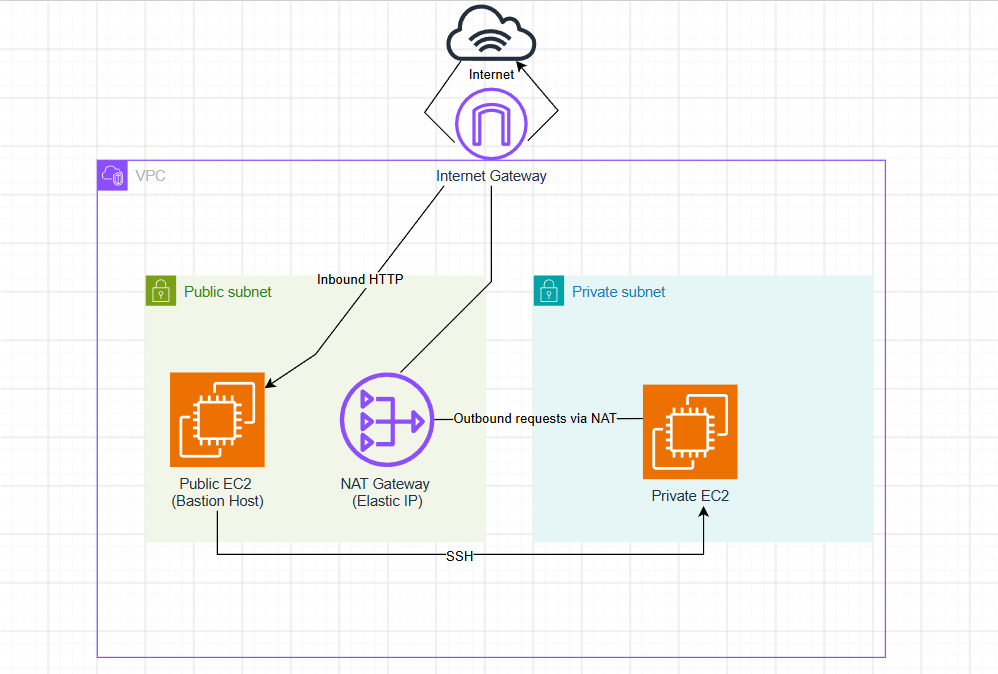

# AWS VPC & EC2 Networking Project

## Project Overview

This project demonstrates the design and configuration of a custom AWS Virtual Private Cloud (VPC) environment, incorporating public and private subnets, EC2 instances, and secure network routing.

The objective was to gain hands-on experience with AWS networking fundamentals by building a network infrastructure from scratch, configuring internet connectivity, controlling network access, and understanding how AWS resources communicate within a VPC.

The infrastructure was provisioned manually using the AWS Management Console to develop a practical understanding of the underlying networking components.

A key aspect of this project was implementing a **bastion host** to provide secure SSH access to a private EC2 instance without exposing it directly to the internet.

## Architecture

The architecture consists of a custom AWS VPC containing a public and private subnet, designed to separate internet-facing resources from internal infrastructure.

An Internet Gateway provides internet connectivity for the public subnet, while a NAT Gateway allows the private EC2 instance to initiate outbound internet connections without requiring a public IP address.

The public EC2 instance also acts as a **bastion host**, providing a secure entry point for SSH access to the private EC2 instance.

### Architecture Diagram

### Network Components

- **VPC:** Provides an isolated virtual network within AWS.
- **Public Subnet:** Hosts the public EC2 instance (bastion host) and NAT Gateway.
- **Private Subnet:** Hosts the private EC2 instance without direct internet exposure.
- **Internet Gateway (IGW):** Enables internet connectivity for public resources.
- **NAT Gateway:** Allows private resources to initiate outbound internet connections without exposing them to unsolicited inbound connections.
- **Route Tables:** Control network traffic by directing packets to the appropriate gateways or destinations.
- **Security Groups:** Act as virtual firewalls to control inbound and outbound traffic for EC2 instances.
- **Bastion Host:** Provides a controlled SSH entry point to the private EC2 instance.

## Implementation

### 1. VPC and Subnet Configuration

Created a custom Virtual Private Cloud (VPC) to establish an isolated network environment within AWS.

The VPC was divided into two subnets to separate public-facing resources from private infrastructure:

- **Public Subnet:** Hosts the public EC2 instance and NAT Gateway, with internet-bound traffic routed through the Internet Gateway.
- **Private Subnet:** Hosts the private EC2 instance without a public IP address, preventing direct access from the internet.

This separation allows public resources to communicate with the internet while keeping private infrastructure isolated from direct external access.

#### VPC Configuration

#### Subnet Configuration

